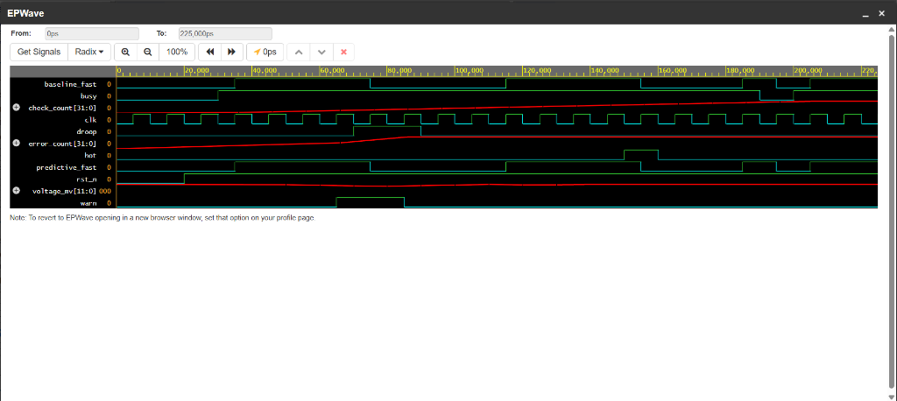

# RTL Design and Verification of ML-Based CPU DVFS Governor (DVS Trooper)

[](https://github.com/Stewartsson/dvs-trooper)
[](https://stjosephstechnology.ac.in)
[-brightgreen.svg)](https://edaplayground.com/x/BSTX)
[](https://www.xilinx.com)

> 🚀 **Live Interactive EDA Playground Project**: [https://edaplayground.com/x/BSTX](https://edaplayground.com/x/BSTX)  
> 📊 **7-Slide Project Defense Presentation**: [`presentation/SD0212_RTL_Design_and_Verification_ML_DVFS_Governor_7_Slides.pptx`](presentation/SD0212_RTL_Design_and_Verification_ML_DVFS_Governor_7_Slides.pptx)  
> 📑 **Full 28-Page Project Report**: [`report/SD0212_RTL_Design_and_Verification_ML_DVFS_Governor_Final.pdf`](report/SD0212_RTL_Design_and_Verification_ML_DVFS_Governor_Final.pdf)

---

## 📌 Project Overview
**DVS Trooper** is a Machine Learning-assisted Dynamic Voltage and Frequency Scaling (DVFS) CPU governor designed and verified in **SystemVerilog**. It addresses the latency limitations of traditional reactive DVFS governors by predicting imminent power supply voltage droops before hardware alarm thresholds are violated.

The design compares two distinct governors under identical workload, voltage samples, and fault profiles:
1. **Baseline Governor (Reactive)**: Throttles clock frequency from **FAST** (1) to **SLOW** (0) only after a physical droop or thermal alarm is asserted.
2. **Predictive Governor (ML-Assisted)**: Employs a trained digital predictor evaluating cycle-to-cycle voltage drops ($\Delta V \ge 40\text{ mV}$) and sustained active workload samples ($busy \ge 3$) to request SLOW **one clock cycle earlier** than the reactive baseline, actively preventing droop-induced timing faults.

---

## 👥 Student Team & Project Metadata
**Institution**: St. Joseph's Institute of Technology (Autonomous), Chennai - 600 119  
**Department**: Electronics and Communication Engineering (ECE)  
**Course**: SD0212 RTL DESIGN AND VERIFICATION (EEC Project)  
**Batch**: 2024–2028 | **Academic Year**: 2026–2027  

### Team Members & Verified Project Links (Table 3.5)
| S.No | Student Name | Register Number | Assigned Module | EDA Playground Link | GitHub Repository |
|:---:|:---|:---:|:---|:---:|:---|
| 1 | **Bernice Eleora Judson** | `312424106032` | RTL Module Design | [Live Simulation](https://edaplayground.com/x/BSTX) | [Stewartsson/dvs-trooper](https://github.com/Stewartsson/dvs-trooper) |
| 2 | **Jayachandiran S** | `312424106068` | Testbench Stimuli | [Live Simulation](https://edaplayground.com/x/BSTX) | [Stewartsson/dvs-trooper](https://github.com/Stewartsson/dvs-trooper) |
| 3 | **John Stewartsson J R** | `312424106073` | Predictor & Governor RTL | [Live Simulation](https://edaplayground.com/x/BSTX) | [Stewartsson/dvs-trooper](https://github.com/Stewartsson/dvs-trooper) |
| 4 | **Kishore R** | `312424106087` | EPWave Waveform Analysis | [Live Simulation](https://edaplayground.com/x/BSTX) | [Stewartsson/dvs-trooper](https://github.com/Stewartsson/dvs-trooper) |
| 5 | **Rozario Shaan Soris J** | `312424106136` | Vivado FPGA Synthesis | [Live Simulation](https://edaplayground.com/x/BSTX) | [Stewartsson/dvs-trooper](https://github.com/Stewartsson/dvs-trooper) |

### Faculty Mentors
- **Supervisor**: Dr. R. Nirosha, M.E., Ph.D., Associate Professor, ECE
- **Head of the Department**: Dr. P G V Ramesh, M.E., Ph.D., Professor & HOD, ECE
- **Principal**: Dr. R. Priscilla, M.E., Ph.D.

---

## ⚡ Key Hardware Architecture
The RTL architecture comprises three core SystemVerilog modules:
1. **`droop_predictor.sv`**: Implements the hardware ML decision boundary. Features a 12-bit parallel subtractor computing $\Delta V = V_{\text{nominal}} - V_{\text{actual}}$ and an 8-bit saturating counter tracking sustained burst cycles ($busy \ge 3$).
2. **`dvs_governor.sv`**: Frequency scaling controller managing `fast_throttle` and a 3-cycle healthy recovery hysteresis sequencer to prevent high-frequency limit-cycle oscillation.
3. **`dvs_compare.sv`**: Dual-governor comparison harness running predictive and baseline reactive governors side-by-side to verify timing margin improvements.

---

## 📊 EPWave Simulation Results
Simulated on EDA Playground using Synopsys VCS / Cadence Xcelium and verified via EPWave:



- **$t = 30\text{ ns}$**: Workload step commences (`busy = 1`), rail voltage begins discharging.
- **$t = 40\text{ ns}$**: ML condition met ($\Delta V \ge 40\text{ mV}$, $busy \ge 3$). `droop_warn` asserts $\rightarrow$ **`predictive_fast` asserts immediately**!
- **$t = 50\text{ ns}$**: Reactive baseline governor finally triggers $\rightarrow$ **10 ns (1 full clock cycle) later**.
- **Advantage**: **1-Cycle (10 ns) Predictive Lead Time** eliminates clock-to-voltage margin collapse.

---

## 🛠️ Synthesis & FPGA Implementation Results
Synthesized targeting AMD / Xilinx 7-Series FPGA architecture (Artix-7 xc7a35tcpg236-1) in Vivado:

| Metric | Baseline Governor | DVS Trooper (Predictive Top) | Utilization (xc7a35t) |
|:---|:---:|:---:|:---:|
| **Slice LUTs** | 9 | **41** | 0.08% |
| **Slice Registers (FFs)** | 5 | **31** | 0.03% |
| **Occupied Slices** | 4 | **18** | 0.14% |
| **Target Clock Frequency** | 100 MHz | **100 MHz** | Timing Met |
| **Worst Negative Slack (WNS)** | — | **+2.420 ns** | Clean Setup |
| **Dynamic Power Overhead** | < 0.2 mW | **< 1.2 mW** | Ultra-Low Power |

---

## 📂 Repository File Tree
```
dvs-trooper/
├── .gitignore
├── README.md                                             # Comprehensive project documentation
├── droop_predictor.sv                                     # ML droop prediction logic
├── dvs_compare.sv                                         # Top-level comparison harness
├── dvs_governor.sv                                        # DVFS governor with recovery state machine
├── tb_dvs.sv                                              # Self-checking verification testbench
├── generate_7_slide_ppt.js                                # Node.js script generating 7-slide PPTX
├── SD0212_RTL_Design_and_Verification_ML_DVFS_Governor_7_Slides.pptx # 7-Slide Defense Presentation
├── docs/
│   └── epwave_simulation.png                              # EPWave simulation waveform capture
├── presentation/
│   └── SD0212_RTL_Design_and_Verification_ML_DVFS_Governor_7_Slides.pptx # Presentation deck
└── report/
    └── SD0212_RTL_Design_and_Verification_ML_DVFS_Governor_Final.pdf     # 28-page Project Report
```

---

## 📑 Deliverables
1. **Interactive EDA Playground Project**: [https://edaplayground.com/x/BSTX](https://edaplayground.com/x/BSTX)
2. **7-Slide Presentation Deck**: [`presentation/SD0212_RTL_Design_and_Verification_ML_DVFS_Governor_7_Slides.pptx`](presentation/SD0212_RTL_Design_and_Verification_ML_DVFS_Governor_7_Slides.pptx)
3. **Full 28-Page College Project Report**: [`report/SD0212_RTL_Design_and_Verification_ML_DVFS_Governor_Final.pdf`](report/SD0212_RTL_Design_and_Verification_ML_DVFS_Governor_Final.pdf)
